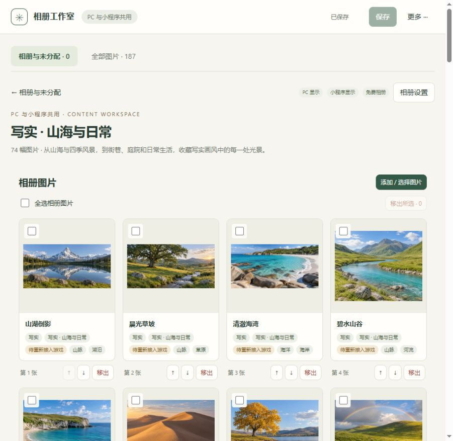

# 图片相册整理

日期：2026-10-12。整理后台当前工作内容，以画风为主分组，保留原有题材标签。先整理未分配图片；随后按用户要求，将「历史版本」和「日常拾光」的图片也分配到画风相册。以下数量为第二次整理后的最新状态。

## 保存与 Web 同步

目前「保存」只更新后台的共用相册内容，Web 不会自动同步。原 PC 前端读取自身 `puzzle-catalog.json`；准备复用的小程序前端也仍读取自身的静态图库与图鉴配置，尚未读取后台相册或两个显示选项。

因此，勾选「在 PC 显示」和「在小程序显示」保存的是展示规划。前端完成相册配置与素材接入，并按应用原有流程发布后，玩家端才会使用这些设置。本次没有替换前端或发布游戏；53 张新图仍保留「待接入游戏」提示。

## 当前相册

| 相册 | 图片数 | 后台展示规划 | 购买设置 |
| --- | ---: | --- | --- |
| 云端奇遇 | 4 | PC、小程序显示 | 原设置，180 金币 |
| 花间灯火 | 6 | PC、小程序显示 | 原设置，180 金币 |
| 山水漫游 | 6 | PC、小程序显示 | 原设置，180 金币 |
| 纸艺 · 奇境旅行 | 16 | PC、小程序显示 | 免费 |
| 二次元 · 异想人物 | 30 | PC、小程序显示 | 免费 |
| 厚涂 · 神兽秘境 | 27 | PC、小程序显示 | 免费 |
| 多元画风 · 灵感小品 | 12 | PC、小程序显示 | 免费 |
| 每日专用 | 2 | 两端隐藏 | 免费 |
| 写实 · 山海与日常 | 74 | PC、小程序显示 | 免费 |
| 平涂 · 彩色故事 | 10 | PC、小程序显示 | 免费 |

共 10 个相册、187 张图片，未分配为 0。第一轮整理此前未分配的 110 张图片：57 张进入四个画风相册，51 张旧归档素材与 2 张每日专用素材进入各自隐藏相册。

第二轮将「历史版本」51 张与「日常拾光」61 张共 112 张按具体画风重新分配：二次元 10 张并入「二次元 · 异想人物」，厚涂 18 张并入「厚涂 · 神兽秘境」，写实 74 张新建「写实 · 山海与日常」，平涂 10 张新建「平涂 · 彩色故事」。两个来源相册移空后从当前内容移除；图片完整保留，没有删图。

「多元画风 · 灵感小品」的 12 张保持第一轮整理结果；图片自身的具体画风与题材标签保持，仍可按标签筛选。两个新相册免费、勾选两端显示，已设置名称、说明与封面。写实封面为「金秋雪岭」，平涂封面为「夏夜花火祭」。

## 保留内容与记录

第一轮整理前先保存了页面中用户尚未保存的移动结果，以四册共 77 张的内容作为基线。「云端奇遇」保持用户编辑后的 4 张，没有恢复成此前的 6 张。其已选入的旧归档与每日图片也保留，不额外移动。

第二轮仅调整两个指定来源相册和对应画风归属。三个购买包、纸艺、多元画风和「每日专用」共六册完整保持。原二次元和厚涂相册只追加图片，原成员顺序、封面、名称、显示与购买设置保持。112 张中存在 26 组同名不同版本，全部按独立图片 ID 保留，没有按标题去重。

全部 187 张图片的标题、画风、题材标签和历史元数据保持。每张图片只归属一个相册；隐藏相册中的图片仍有归属，不回到未分配。每日玩法继续采用原有规则。

继续使用同一个当前工作内容，第一轮修订号由 5 更新到 6，第二轮由 6 更新到 7，没有新建另一份草稿。正式后台已刷新，页面显示「已保存」、10 个相册、187 张图片、未分配 0。

第一轮私有记录位于 `work/album-organization-20261012/result.json`，含 110 张图片的归属明细；备份为 `work/backups/before-album-organization-1791799665441.sqlite`。

第二轮私有记录位于 `work/album-redistribution-20261012/result.json`，含 112 张图片的来源与目标相册映射，以及两个原相册的完整内容；备份为 `work/backups/before-style-redistribution-1791804661562.sqlite`。这些文件只保存在后台私有目录，不加入公开资源或版本控制。

## 聚焦验证

相册结构与图片引用校验通过。第二轮实际保存结果与操作前备份对照确认全部 187 张图片元数据和 12 种画风分组一致，六个无关相册完整保持；187 个成员 ID 全部唯一且覆盖全部素材，112 张移动结果均与图片画风一致。刷新真实后台后确认新相册、成员数及已保存状态正确。

第一轮入口为 `scripts/organize-unassigned-albums.mjs`，无未分配图片时直接退出；已有同名整理相册且又出现未分配图片时要求重新审阅。

第二轮入口为 `scripts/redistribute-style-albums.mjs`，只分配两个指定免费来源相册，未知画风或来源相册变化时先要求审阅；两册均已移除时直接退出。两个入口均默认预览，显式添加 `--apply` 才保存，保存前创建私有 SQLite 备份。

共用相册的日常规则见 [PC 与小程序共用相册](2026-10-12-PC小程序共用相册.md)，本记录中的数量为本次整理后的最新状态。
