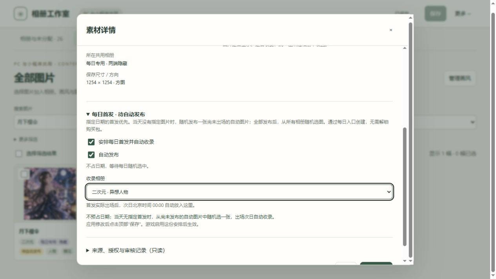

# 每日拼图与相册收录

更新：2026-10-13。每日首发使用自动发布候选池，不预先占用日期。相册仍是图片的唯一归属，图鉴和购买包共用这份相册内容。

## 每天怎么选图片

每天北京时间 00:00 后，服务为当前日期选定一张图片，按以下顺序处理：

| 优先级 | 条件 | 选图方式 |
| --- | --- | --- |
| 1 | 当天有手动指定日期的首发 | 使用指定图片 |
| 2 | 当天没有手动排期，还有未发布的自动发布图片 | 从这些图片随机选一张 |
| 3 | 没有当天排期，自动发布候选池也已用完 | 从所有相册的可用图片随机选一张 |

第三种情况包含购买相册和隐藏相册。相册隐藏只控制普通图库与图鉴展示，每日入口仍可推荐其中的图片。未分配图片不参加相册随机；尚未交付到游戏的素材也不会被选中。每日入口创建的是公开房间，无需解锁图包，也不扣建房券，仍遵守现有房间数量等限制。当天免费体验不授予整包所有权。

当天选定的结果保存在出场记录中。同一天所有玩家看到相同图片，刷新、服务重启或修改未来计划都不会重新抽取。服务只记录实际运行中的当天，不推算或补造过去的出场日期。

## 平时怎么操作

1. 在图片详情勾选「安排每日首发并自动收录」。
2. 「自动发布」默认勾选，收录相册可以立即选择。保持自动勾选即可，无需选日期。
3. 如果这张图需要节日等指定日期，取消「自动发布」，再选择首发日期。
4. 应用图片修改后，点击顶部「保存」。候选池显示「待自动发布」，只有手动计划显示具体日期。
5. 实际首发结束后的北京时间次日 00:00，图片自动进入预选相册，不需要手动搬图。

自动图片没有保留日期。因此，新增一张手动日期图片只占用该日期，其他自动图片继续留在候选池，等待没有手动排期的日子。旧的自动日期安排会转换为无日期候选；已有可信出场事实继续保留。

预选相册不会提前移动图片。已安排首发的图片在首次实际出场结束前，不通过普通图库或图鉴提前展示；首发当天通过每日入口体验。收录后仍遵守目标相册的 PC / 小程序显示选项与购买设置，隐藏相册不会自动变为公开。已有相册随机推荐只增加出场记录，保留图片原归属，不重新收录。

## 原来的三张每日图片

| 图片 | 稳定图片 ID |
| --- | --- |
| 月下樱伞 | `daily-moonlit-cherry-umbrella-v1` |
| 灯舟琴韵 | `daily-lantern-lake-violin-v1` |
| 云海鲸歌 | `daily-sky-whale-islands-v1` |

它们是原静态每日池，旧代码按北京时间固定轮换。新接入启用后，不再以这三张图作为唯一默认池。三张图依然保留原图片 ID 和资源，可以与其他图片一样整理相册或安排首发。旧算法可以推算目录选择，但不能证明过去部署实际展示过什么，所以不补造它们的历史首次出场日期。

## 后台怎么看出已发布

| 状态 | 含义 |
| --- | --- |
| 待自动发布 | 已进入无日期候选池，尚未确认实际出场 |
| 指定日期 | 已手动指定首发日期 |
| 今日每日 | 今天实际生效的图片 |
| 已出场 · 待收录 | 已确认首发，等待次日自动收录 |
| 已收录 | 已归入预选相册，保留首次出场日期 |
| 待游戏确认 | 手动日期已到，但没有可信实际出场记录 |
| 原每日图片 | 原三张每日素材，历史首次出场日期未知 |

图片详情和卡片保留出场、收录信息。「更多筛选」中的每日状态可集中查找。保存计划不等于游戏实际出场，日期到期也不会凭空标成已发布。

## 运行接入与资源边界

后台 `dailyPlans` 与当前工作内容一起保存。自动条目使用 `autoPublish: true` 和 `date: null`；手动条目保留日期。每张图只能有一份首发安排，只有手动计划参与日期冲突检查。快照和来源合并保留这些安排。

后台生成公开 `jigsaw-daily-content/v2` 配置，位于 `content-admin/work/daily-bridge/configuration.json`。它包含手动日期、自动候选、相册随机池和相册描述，不含管理员信息或玩家身份。小游戏的实际出场记录位于独立 `work/daily-appearances` 目录；后台核对配置摘要后才确认出场与收录。旧 v1 配置和可信出场记录继续兼容。

本地小游戏使用 `npm run mobile:preview` 启动时，会在存在相邻后台公开配置的情况下自动接入；也可显式设置 `MOBILE_DAILY_CONFIG` 与 `MOBILE_DAILY_APPEARANCES` 覆盖路径。已经运行的服务需要重新启动才能启用接入。正式外部游戏仍须按既有发布流程部署，后台保存不会自动上线。原 `puzzle-play` PC 项目保持独立；共用 Web 采用小程序前端时，读取同一小游戏服务。

后台现有 187 张图片中，134 张已有保留游戏资源，包括 82 张当前发布图和 52 张历史归档图。新每日接入可以使用这些已验证资源，原默认图库不因此整体改版。另 53 张新图仍为「待接入游戏」：可以先保存相册、标签与首发安排，但实际候选池暂不包含它们。

## 完成事实与数据保护

首发当天符合原贡献条件的玩家即可保存这张图的完成事实。次日相册展示使用同一个图片 ID，保留各难度完成记录。每日免费体验不会解锁整个购买包，重复结算不会重复发放金币、碎片或奖励。

出场和收录事实保存在独立记录中。自动收录只移动该张图并修复封面，保留其他图片、标签、价格和奖励；修订号与事务防止覆盖并发整理。已收录图片后续被用户移动时，不会被重复收录强行搬回。

后台定期同步。没有未保存编辑的页面可以载入收录变化；有编辑时保留本地内容并提示合并。真实玩家数据库未用于开发验证。旧每日房间已结算事实保持，历史图鉴补录需另行依据有效完成证据处理，不重放奖励。

## 聚焦验证

本轮重点验证：自动候选不占日期、手动日期优先、未发布候选只首发一次、相册随机兜底、当天结果固定、次日收录和购买图每日免费创建。测试使用独立临时目录与测试玩家数据，不替换正式数据。具体运行契约见 [小游戏每日接入](../../jigsaw-nook-taptap/docs/daily-content.md)。

2026-10-13，本地后台 3214 和游戏预览 3211 已启动并接入 v2。当前保存内容没有手动或自动首发计划，从 109 张已分配且可用的相册图片中选出了「秋庭茶舍」，实际出场记录已同步到后台；原有 187 张图片与 13 个相册的名称、标签、价格和成员保持。本地规则生效，正式线上仍随游戏发布更新。

自动发布界面示例来自独立验证数据；示例中的勾选没有写入真实图片安排。

