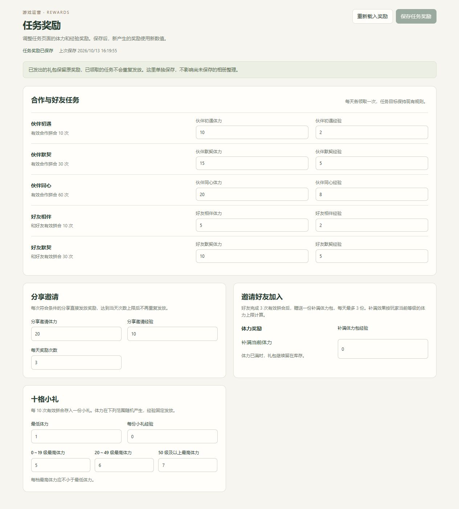

# 任务奖励管理

在相册工作台顶部进入「任务奖励」，集中调整八项任务奖励的金币、经验与小程序体力。Web 与小程序共用同一份数值；Web 跳过体力，不显示、不消耗也不发放体力，其余金币、经验奖励相同。任务条件保留原规则；不需要切换相册、历史版本或草稿。

正式双端配置接入正在开发，尚未部署到线上。统一流程见 [双端同步接入](2026-10-13-双端同步接入.md)。

## 日常操作

1. 打开 [相册工作台](http://127.0.0.1:3214/)，使用原管理员账号登录。
2. 进入「任务奖励」，修改需要调整的数值。
3. 点击「保存任务奖励」，保留后台编辑，并用于已接入的本地游戏预览。
4. 正式接入完成后，先保存其他需要一同提交的相册和游戏设置，再点击顶部「提交到双端」，核对已保存版本并确认提交。两端校验并成功提交后，新产生的奖励采用该版本。

任务奖励单独保存，不会替换尚未保存的图片、标签、每日首发或相册编辑。保存不等于正式提交，未保存输入也不会进入正式版本。多人同时修改奖励时，以版本号检查冲突；过期页面不能覆盖其他人已保存的数值。

## 可以调整哪些奖励

| 项目 | 可调整内容 | 保留的条件 |
| --- | --- | --- |
| 伙伴初遇 | 金币、经验、小程序体力 | 每日 10 次协作拼合 |
| 伙伴默契 | 金币、经验、小程序体力 | 每日 30 次协作拼合 |
| 伙伴同心 | 金币、经验、小程序体力 | 每日 60 次协作拼合 |
| 好友相伴 | 金币、经验、小程序体力 | 每日 10 次好友拼合 |
| 好友默契 | 金币、经验、小程序体力 | 每日 30 次好友拼合 |
| 分享邀请 | 每次金币、经验、小程序体力、每日奖励次数 | 成功分享或复制完整邀请链接后领取 |
| 好友加入 | 邀友礼包附带的金币与经验 | 首次接受邀请后完成 3 次有效拼合，每日最多奖励 3 位好友 |
| 十格小礼 | 每份金币与经验、小程序体力下限和三个等级段上限 | 每 10 次有效拼合发一份；等级段为 0–19、20–49、50 级及以上 |

八处金币均使用 0–100000 的整数，填 0 表示不额外发金币。旧奖励配置缺少金币字段时按 0 读取，保留原有体力与经验，不会因读取而写回或重置后台存档。

小程序的好友加入礼包仍补满体力，补至开包时的当前体力上限，不设固定体力数；体力已满时继续保留礼包，不消耗库存。Web 同类礼包只按配置发放金币和经验，不要求体力不足才可开启。

所有奖励数值使用非负整数。十格小礼的下限不能超过任一等级段的上限；分享奖励次数使用 1–20 的整数。具体填写范围以页面和保存校验为准。

## 调整后什么时候生效

保存后的新数值供本地预览使用；正式接入完成后，只有通过顶部流程成功提交的新版本才影响正式游戏。新数值影响之后新发放的奖励。例如，伙伴初遇礼包从 0 金币改为 5 金币，修改前已存入的礼包仍按原快照开启；采用新版本后发放的礼包才增加 5 金币。同一库存中不同批次的礼包可以同时存在，按各自实际奖励兑现。

调整不会清空任务进度、重置每日已领奖状态、重新奖励已达标邀请，或改写已到账的金币、体力与经验。已有礼包不追补新金币。网络中断后的重试也继续使用原来那笔操作的结果，避免重复到账。

每日任务和分享奖励次数按北京时间 00:00 刷新，已经存下的礼包持续保留。调整分享奖励次数不会清除当天已分享次数：例如当天已领 3 次，限额改为 5，则还可再领 2 次；改为 2 则当日不再发放额外分享奖励。

## 配置接入与保管

奖励配置独立保存在管理网站自身的工作目录中。公开配置仅包含稳定任务 ID、奖励数值和版本信息，不包含玩家、管理员、邀请码或其他私人数据。管理网站不需要读取真实玩家数据库。

本地预览的公开桥接文件为 `content-admin/work/task-rewards/configuration.json`。正式双端接入使用统一发布版本中的 `task-rewards.json`，配置格式相同；发布文件包含配置读取模块及默认奖励值。未指定外部配置的游戏仍使用原来的默认值。

本地配置保存不等于正式上线。正式配置接入完成后，顶部「提交到双端」会把已保存的任务奖励、相册、每日安排和游戏设置放入同一发布版本，两个后端采用相同版本；流程见 [双端同步接入](2026-10-13-双端同步接入.md)。当前尚未部署这套正式双端接入。

「更多 → 历史与备份」只保留内容备份、恢复与旧版更新文件导出，不是双端正式提交入口。相册当前内容、每日选图记录与玩家数据库不属于单独的任务奖励配置文件。

## 兼容约定

配置格式为 `jigsaw-task-rewards/v1`，包含：

- `tasks`：五个每日任务的稳定 ID、`energy`、`xp`、`coins`。
- `invitationShare`：`energy`、`xp`、`coins` 与 `dailyLimit`。
- `invitationFriend`：固定 `full-energy` 效果与 `xp`、`coins`。
- `tenGrid`：`energyMin`、三个等级段 `energyMaxByTier`、`xp`、`coins`。

管理接口为独立的 `GET /api/task-rewards` 与 `PUT /api/task-rewards`；保存带当前 `revision`，服务端验证完整配置并检查版本后写入。配置桥接包含内容摘要，游戏服务校验完整内容后才采用。

各处 `coins` 在旧配置中可缺失，规范化读取时补 0。旧浏览器同版本保存若省略金币字段，会继承当前已保存值；新版表单明确提交 0 才会清零，过期版本仍不能覆盖。

旧礼包按创建时存下的奖励兑现；旧定额邀友礼包、补满包及各等级十格礼包的种类继续可读。Web 跳过同一配置里的体力字段，不另建一套任务奖励。稳定任务 ID 与原来的唯一发奖来源保持不变，修改奖励不能生成第二份同日任务礼包。

## 本次接入

2026-10-13，管理页加入全部八处金币设置，任务奖励继续独立于相册与成长设置保存。旧奖励读取保留原数值，新增金币缺省为 0；已有金币显式保存后，旧表单不会因漏字段把它清零。

针对金币管理的聚焦验证与原有管理验证共 7 项通过，覆盖旧存档逐字保留、奖励保存、原体力与经验保留、表单读回、非法数值、版本冲突及旧浏览器兼容。测试数值只写入独立验证目录，没有操作真实奖励存档或玩家数据库。正式双端接入与部署仍在开发，运行状态以 [双端同步接入](2026-10-13-双端同步接入.md) 为准。

以下为此前尚未加入金币字段的页面预览，仅用于记录界面演进；当前页面以管理网站为准。

