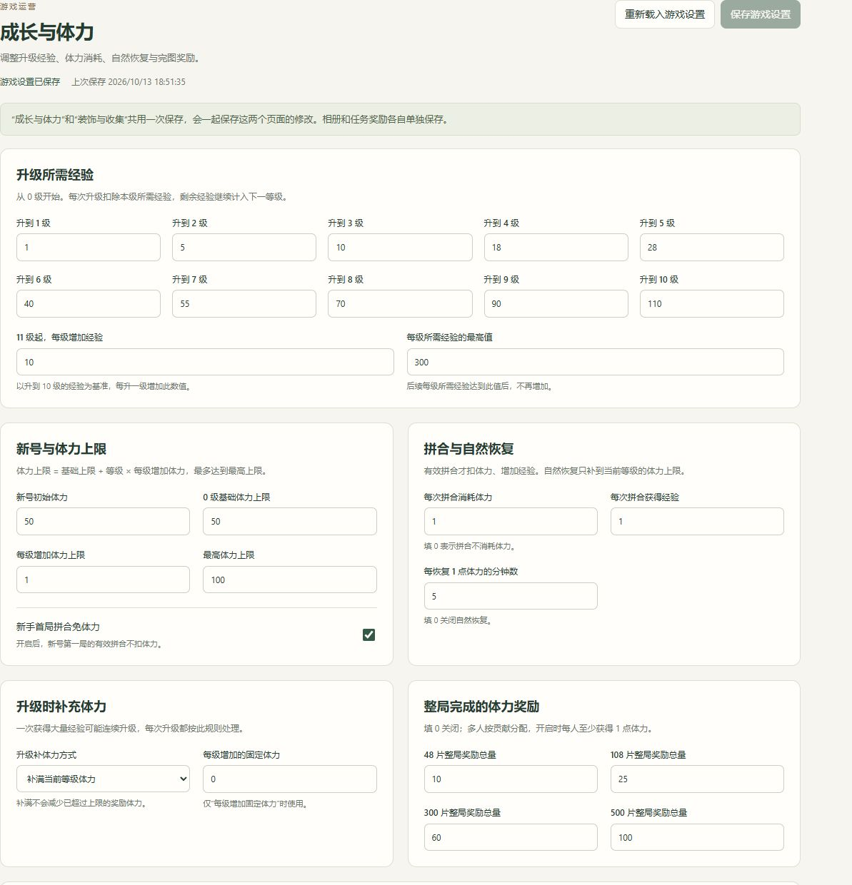
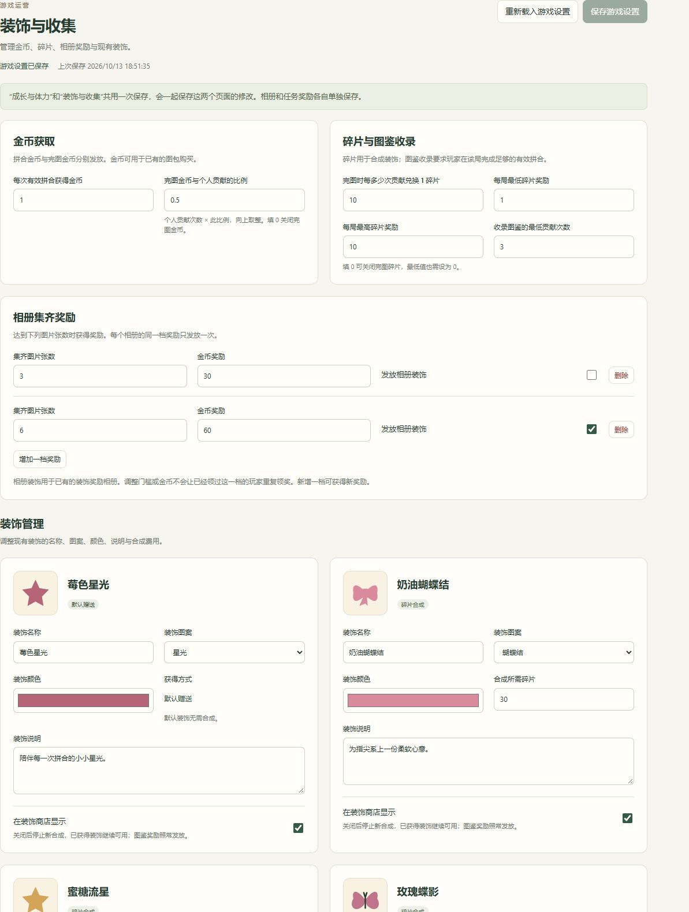

# 成长、体力与装饰管理

后台入口：<http://127.0.0.1:3214/>。本轮将游戏原有升级、体力和装饰收集数值接入管理网站，初次载入保留现有数值，具体平衡由管理员设置。

## 操作方法

顶部进入「成长与体力」或「装饰与收集」。这两页共用一份游戏设置：跨页切换保留输入，点击「保存游戏设置」会一起保存两页的编辑。顶部「保存相册」只保存相册；「任务奖励」也使用自身保存按钮。可以用 Ctrl+S 保存正在编辑的这一类内容。

## 成长与体力

| 设置 | 含义 |
| --- | --- |
| 升到 1～10 级所需经验 | 逐级设置从上一级升来的经验门槛；剩余经验保留 |
| 11 级起每级增加经验、最高值 | 从第 10 级门槛开始递增，达到最高值后固定 |
| 新号初始体力 | 只影响之后创建的玩家 |
| 基础上限、每级增加上限、最高上限 | 当前上限为基础值加等级乘增量，并受最高值限制 |
| 拼合消耗体力、获得经验 | 每次有效拼合采用这些数值；体力消耗可设为 0 |
| 新手首局拼合免体力 | 控制首个未完成房间的拼合免体力；首局工具规则独立 |
| 自然恢复 | 每恢复 1 点体力需要的分钟数，支持小数；0 关闭 |
| 升级补体力 | 可选补满当前等级、每级补充固定数值、完全不补充 |
| 48/108/300/500 档整局体力奖励 | 独自完成获得整池，多人按贡献分配；0 关闭，开启时每位贡献者至少 1 点 |

前 20 级表格会随输入实时变化，显示本级门槛、累计经验和体力上限。一次得到多级所需经验时，会逐级扣除经验并按每级补体力方式处理。补满规则不扣除已经超过上限的奖励体力。

修改经验门槛后不立即重算已有玩家等级或清零其经验；下一次获得正数经验时，按当前门槛继续升级。已有超上限体力不会因为降低上限被扣回。等级上限公式立即在游戏档案里采用新值。

## 装饰与收集

- 每次有效拼合金币、完图金币系数。完图金币为本人贡献次数乘系数后向上取整，系数 0 关闭此奖励。
- 完图碎片的贡献兑换步长、最低和最高奖励。最低、最高同时设 0 可关闭碎片产出。
- 图鉴收录所需的最低个人贡献。
- 各相册的集齐档位已移至该相册设置，逐档选择张数、金币和赠送装饰，详见 [相册独立奖励](2026-10-13-相册独立奖励.md)。
- 8 件现有装饰的名称、说明、图案、颜色和商店展示；碎片合成装饰可设置费用。图案使用游戏已经支持的七种形状，颜色使用颜色选择器并显示预览。

现有装饰的身份和默认赠送/合成/相册奖励来源保留兼容。每个相册可选择任意现有装饰作为集齐奖励，原相册绑定不限制新选择；装饰页面显示实际的赠送相册。装饰商店隐藏会停止新合成；已有装饰继续展示并可装备，图鉴达成奖励照常发放。

## 已有数据与生效范围

游戏设置与相册、任务奖励独立存储，保存带版本冲突保护，冲突时保留本窗口输入。已有玩家等级、剩余经验、金币、碎片、已购图包与装饰持有记录不会重置；已有奖励记录与操作重试结果继续使用原值。

集齐奖励采用稳定档位身份。修改已有一档的门槛或金币，不会让已经领过该档的玩家再次领取；增加一档是新增奖励。删除一档不会扣回过去已经发放的金币或装饰。旧有 3 张/6 张领取历史会兼容到原档位。未领取的新奖励在之后符合条件的完局时计算。

任务页的十格、分享、好友礼包数值仍在「任务奖励」编辑；礼包所含体力与经验保留发放时的数值，但经验触发的升级采用当时最新成长规则。

本地小游戏服务在下一次请求时读取保存后的公开配置，前端说明和奖励展示也使用服务返回的当前规则。正式线上需要发布新版运行模块及前端，并接入配置文件；本轮不部署外网，不改原 PC 游戏项目。

公开配置：`content-admin/work/game-settings/configuration.json`，由后台原子更新；游戏运行环境可设置 `MOBILE_GAME_SETTINGS_CONFIG` 指向该文件。`scripts/start-mobile.mjs` 在启动时自动发现本地管理配置。配置只有公开游戏数值，不含玩家、管理员、密码或会话。

## 验证与保管

聚焦验证覆盖配置边界、独立保存、鉴权、版本冲突、运行中热更新、升级补充方式、恢复关闭、金币/碎片数值、里程碑历史兼容、装饰持有保留与重试结果。管理界面已验证跨页修改一次保存、预览即时变化、增加/删除奖励档位及装饰编辑。模拟后台用隔离数据，未改实际奖励数值。

功能接入前分别保留管理数据库和本地游戏数据库备份于各自 `work/backups`。相册与任务奖励的保存内容已记录于管理目录 `work/game-settings-feature-baseline.json`，用于核对功能接入没有覆盖当前整理和已经调整的任务奖励。运行数据、备份和公开配置均不提交版本控制。

