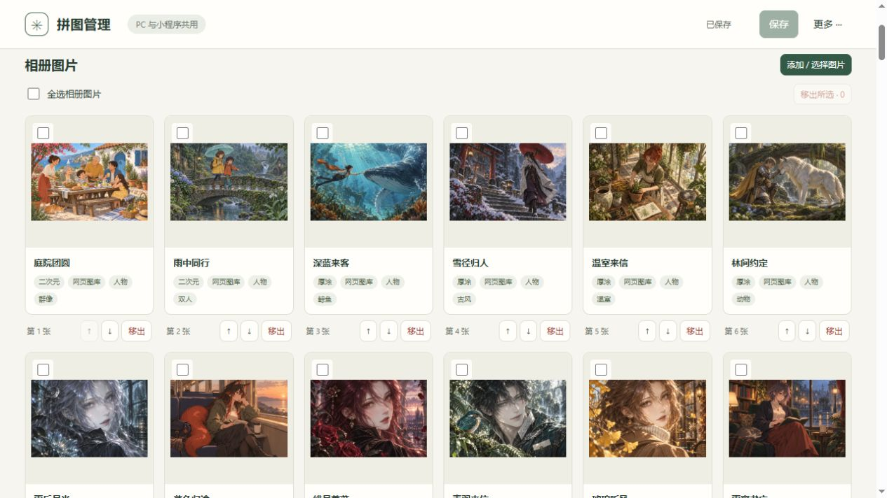

# 相册恢复与保存修正

本次找回旧后台页面中尚未写入总保存的完整整理，已保存为当前工作内容：15 个相册、187 张图片全部分配，未分配为 0。未恢复整个数据库，成长、体力、任务奖励与装饰设置分别保留。

关键相册保留如下：网页图库 153 张（PC 显示，小程序隐藏）；纸艺 · 奇境旅行 10 张；厚涂 · 神兽秘境 6 张；缤纷假日 8 张；花间灯火 3 张；节日 ★ 2026 1 张；纸艺 · 动物世界 6 张。其余原有空相册仍保留。全部成员、顺序、名称、封面、显隐、价格和旧奖励记录由原页面提交，未按数量重新拼凑。

问题原因：旧相册弹窗「应用设置」只修改当前页面，尚需点击顶部「保存」；「保存游戏设置」保存成长与装饰，不保存相册。旧页面保留了整理后的 15 个相册，而新页面读取到后台旧版 13 个相册，造成撤销的观感。查验相册保存审计和各份数据库备份，没有发现已落库内容被回滚。来源指纹变化也未改变内容基线或已存相册。

修正后：相册弹窗提供「保存相册设置」，点击直接保存后台，同时保存本页的图片归属和顺序。请求失败时输入和本机暂存保留。拖动、批量标签等整理仍使用顶部相册保存；本机按管理员、工作内容和页面分别暂存未保存相册编辑，版本相同时提供恢复按钮，不自动覆盖后台新版本。成长、装饰和任务奖励的未保存输入不参与相册恢复。

来源代码发生变化但内容文档完全相同时，后台不再将其显示成相册未保存编辑。

当时两处相册奖励入口重复，实际游戏只读取「装饰与收集」的通用规则。根据后续确认，已调整为每个相册在自身设置中独立选择赠送装饰及集齐门槛，并接入实际游戏发奖；「装饰与收集」只管理装饰资料和通用产出。当前规则见 [相册独立奖励](2026-10-13-相册独立奖励.md)。

恢复前后逐项核对成长与装饰完整文档、保存版本、时间以及任务奖励，均完全一致。用户当前成长设置包括初始体力 30、基础上限 30、每 2 分钟恢复 1 点、首局免体力关闭；前十级门槛为 2、5、10、20、30、50、65、80、100、110。后续设置若由用户再次保存，应以后台最新文档为准。

恢复前后备份分别保存在 `work/backups/before-album-recovery-*.sqlite`、`work/backups/after-album-recovery-*.sqlite`。找回的完整相册文档保存于 `work/recovered-album-document.json`，当前成长与任务奖励对照保存于 `work/album-recovery-current-baseline.json`。这些私有运行文件不提交。

聚焦验证：相册弹窗保存后刷新仍保留名称和显隐，独立成长设置不变；恢复缓存隔离不同管理员和页面，损坏、超大和存储失败均不阻断正常操作。未改玩家数据或游戏数值。

