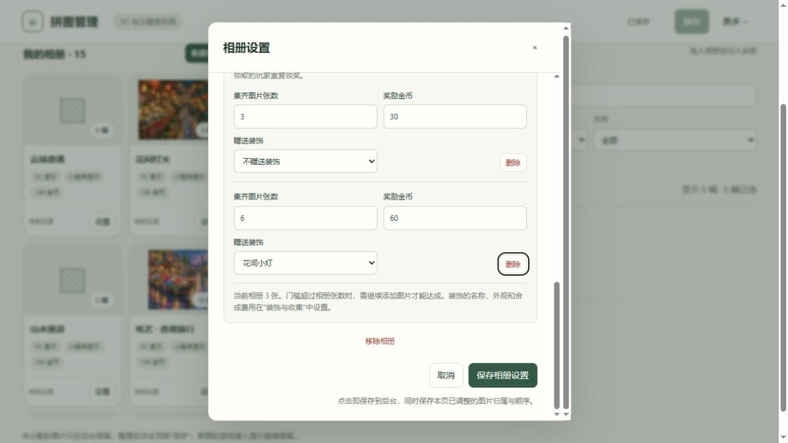

# 相册独立奖励

每个相册分别决定赠送哪件装饰和收集门槛。点击相册卡片「设置」，在「相册集齐奖励」中增加档位，填写集齐图片张数、奖励金币，并选择赠送装饰；点击「保存相册设置」直接保存。免费相册、购买相册均适用，可以选择全部八件现有装饰，也可以只发金币。同一件装饰可作为多个相册的奖励。

「装饰与收集」管理装饰名称、图案、颜色、说明、合成费用、商店展示和通用金币碎片产出。该页面不再编辑通用相册奖励模板。相册和成长设置各自保存；编辑相册不修改成长与体力或任务奖励。

新相册配置写入 `content-admin/work/albums/configuration.json`，schema 为 `jigsaw-albums/v1`。本地游戏启动会自动发现，运行时每次操作固定读取一份配置。已接入的游戏按相册当前成员计算收集数量，按该相册每档目标、金币及 decorationId 发奖。所有相册均导出，展示按照 PC/小程序勾选过滤；未交付新图不进入游戏配置，每日首发保持现有次日归册规则。正式线上仍须发布新服务和客户端并设置 `MOBILE_ALBUMS_CONFIG`，不会自动部署。

旧里程碑的身份由原目标派生为 `milestone-3`、`milestone-6` 等；修改同一档目标、金币或装饰后仍保留同一身份，已领取者不重复领奖，发出的奖励保留当时快照。新建一档具有新的独立身份，会成为新的可领奖励。装饰持有记录保留。原三图包已购买图片的使用权益保留，新购买还会记录当时图片权益；以后移动相册成员不撤销这些已购买权益。相册奖励计数仍按当前归属计算。

旧游戏设置中的 milestones 保留用于未配置相册文件的兼容运行；连接相册配置时仅使用各相册自身奖励，不叠加旧模板。旧相册的 decorationId 同样保留兼容字段，实际赠送以每档选择为准。

本轮未替用户分配新的奖励数值。启动前后检查实际后台相册版本 10、成长设置版本 5、任务设置版本 3，三份完整保存文档逐字一致；15 个相册、187 张图片归属保持，其中 134 张已交付资源进入公开配置。

聚焦验证覆盖独立保存后重载、成长设置保留、稳定奖励身份、已领快照、免费相册发奖、永久购买权益、每日图片过滤。类型检查、图片校验、共享小游戏与 H5 构建通过。隔离界面验证中测试选择奶油蝴蝶结、集齐 6 张奖励 77 金币，保存重载仍保留；这些测试数值未写入实际相册。

