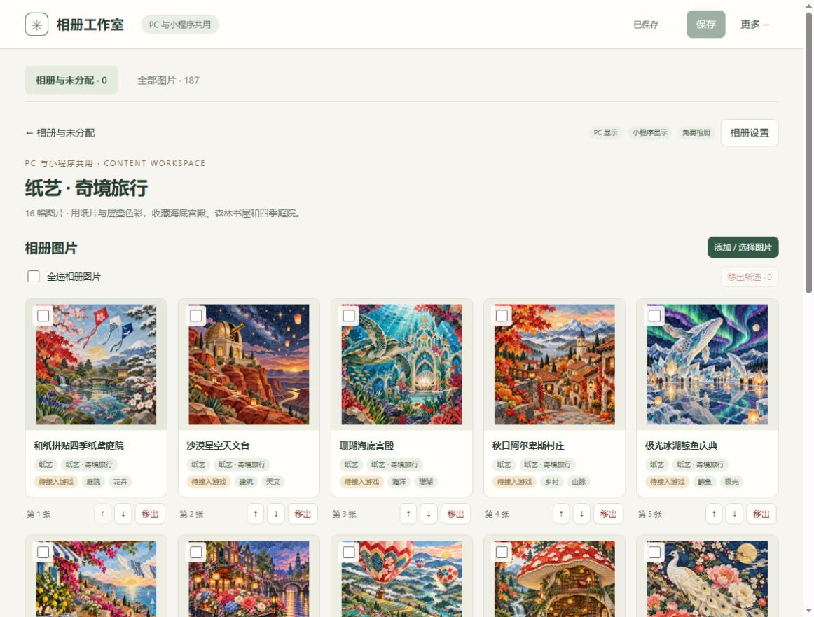

# 图片相册整理

日期：2026-10-12。整理后台当前工作内容中的未分配图片，以画风为主分组，保留原有题材标签。

## 保存与 Web 同步

目前「保存」只更新后台的共用相册内容，Web 不会自动同步。原 PC 前端读取自身 `puzzle-catalog.json`；准备复用的小程序前端也仍读取自身的静态图库与图鉴配置，尚未读取后台相册或两个显示选项。

因此，勾选「在 PC 显示」和「在小程序显示」保存的是展示规划。前端完成相册配置与素材接入，并按应用原有流程发布后，玩家端才会使用这些设置。本次没有替换前端或发布游戏；53 张新图仍保留「待接入游戏」提示。

## 当前相册

| 相册 | 图片数 | 后台展示规划 | 购买设置 |
| --- | ---: | --- | --- |
| 云端奇遇 | 4 | PC、小程序显示 | 原设置，180 金币 |
| 花间灯火 | 6 | PC、小程序显示 | 原设置，180 金币 |
| 山水漫游 | 6 | PC、小程序显示 | 原设置，180 金币 |
| 日常拾光 | 61 | PC、小程序显示 | 免费 |
| 纸艺 · 奇境旅行 | 16 | PC、小程序显示 | 免费 |
| 二次元 · 异想人物 | 20 | PC、小程序显示 | 免费 |
| 厚涂 · 神兽秘境 | 9 | PC、小程序显示 | 免费 |
| 多元画风 · 灵感小品 | 12 | PC、小程序显示 | 免费 |
| 历史版本 | 51 | 两端隐藏 | 免费 |
| 每日专用 | 2 | 两端隐藏 | 免费 |

共 10 个相册、187 张图片，未分配为 0。本次新建后六册，整理此前未分配的 110 张图片：57 张进入四个画风相册，51 张旧归档素材与 2 张每日专用素材进入各自隐藏相册。

纸艺、二次元和厚涂分别成册；数量较少的写实、平涂、水彩、水墨、版画、彩绘玻璃、粉彩与装饰插画汇入「多元画风 · 灵感小品」。图片自身的具体画风与题材标签保持，仍可按标签筛选。新相册已设置名称、说明和封面。

## 保留内容与记录

整理前先保存了页面中用户尚未保存的移动结果，以四册共 77 张的内容作为本次基线。四个原相册的成员、顺序、封面、显示选项、价格和奖励完整保留；「云端奇遇」保持用户编辑后的 4 张，没有恢复成此前的 6 张。其已选入的旧归档与每日图片也保留，不额外移动。

全部 187 张图片的标题、画风、题材标签和历史元数据保持。每张图片只归属一个相册；隐藏相册中的图片仍有归属，不回到未分配。每日玩法继续采用原有规则。

继续使用同一个当前工作内容，修订号由 5 更新到 6，没有新建另一份草稿。正式后台已刷新，页面显示「已保存」、10 个相册、187 张图片、未分配 0。

私有整理记录位于 `work/album-organization-20261012/result.json`，含本次 110 张图片的相册归属明细。操作前 SQLite 备份位于 `work/backups/before-album-organization-1791799665441.sqlite`。这些文件只保存在后台私有目录，不加入公开资源或版本控制。

## 聚焦验证

相册结构与图片引用校验通过；实际保存结果与操作前备份对照确认原四册、全部图片元数据和画风分组保持。187 个相册成员 ID 全部唯一且覆盖全部素材。刷新真实后台后确认新增相册及纸艺册 16 张图片均显示正确。

整理入口为 `scripts/organize-unassigned-albums.mjs`，默认只预览，显式添加 `--apply` 才保存。无未分配图片时直接退出；已有同名整理相册且又出现未分配图片时要求重新审阅，避免重复创建或误改已有内容。

共用相册的日常规则见 [PC 与小程序共用相册](2026-10-12-PC小程序共用相册.md)，本记录中的数量为本次整理后的最新状态。
