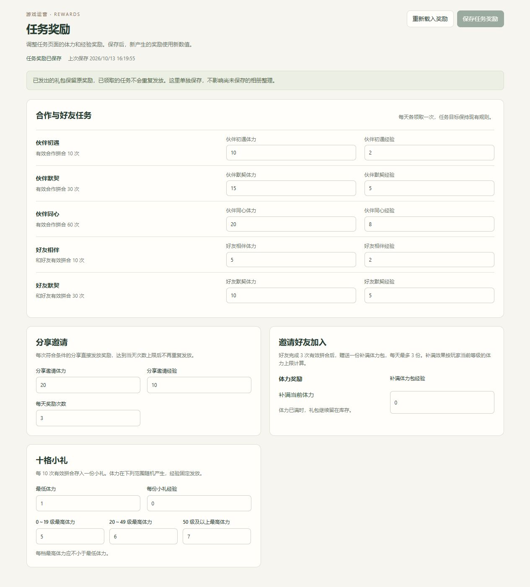

# 任务奖励管理

在相册工作台顶部进入「任务奖励」，集中调整游戏任务的体力和经验奖励。任务条件保留原规则；不需要切换相册、历史版本或草稿。

## 日常操作

1. 打开 [相册工作台](http://127.0.0.1:3214/)，使用原管理员账号登录。
2. 进入「任务奖励」，修改需要调整的数值。
3. 点击「保存任务奖励」。已接入此配置的本地游戏服务会在之后发放奖励时使用新数值。

任务奖励单独保存，不会替换尚未保存的图片、标签、每日首发或相册编辑。多人同时修改奖励时，以版本号检查冲突；过期页面不能覆盖其他人已保存的数值。

## 可以调整哪些奖励

| 项目 | 可调整内容 | 保留的条件 |
| --- | --- | --- |
| 伙伴初遇 | 体力、经验 | 每日 10 次协作拼合 |
| 伙伴默契 | 体力、经验 | 每日 30 次协作拼合 |
| 伙伴同心 | 体力、经验 | 每日 60 次协作拼合 |
| 好友相伴 | 体力、经验 | 每日 10 次好友拼合 |
| 好友默契 | 体力、经验 | 每日 30 次好友拼合 |
| 分享邀请 | 每次体力、经验、每日奖励次数 | 成功分享或复制完整邀请链接后领取 |
| 好友加入 | 补满体力包附带的经验 | 首次接受邀请后完成 3 次有效拼合，每日最多奖励 3 位好友 |
| 十格小礼 | 体力下限、三个等级段的体力上限、经验 | 每 10 次有效拼合发一份；等级段为 0–19、20–49、50 级及以上 |

好友加入奖励仍是补满体力包。它补至开包时的当前体力上限，不设固定体力数；体力已满时继续保留礼包，不消耗库存。

所有奖励数值使用非负整数。十格小礼的下限不能超过任一等级段的上限；分享奖励次数使用 1–20 的整数。具体填写范围以页面和保存校验为准。

## 调整后什么时候生效

新数值影响之后新发放的奖励。例如，伙伴初遇礼包从体力 10 改为 15，保存前已存入的礼包仍按原来的体力 10 开启；保存后新发放的礼包才使用体力 15。同一库存中不同批次的礼包可以同时存在，页面按实际库存显示奖励范围。

调整不会清空任务进度、重置每日已领奖状态、重新奖励已达标邀请，或改写已到账的体力与经验。网络中断后的重试也继续使用原来那笔操作的结果，避免重复到账。

每日任务和分享奖励次数按北京时间 00:00 刷新，已经存下的礼包持续保留。调整分享奖励次数不会清除当天已分享次数：例如当天已领 3 次，限额改为 5，则还可再领 2 次；改为 2 则当日不再发放额外分享奖励。

## 配置接入与保管

奖励配置独立保存在管理网站自身的工作目录中。公开配置仅包含稳定任务 ID、奖励数值和版本信息，不包含玩家、管理员、邀请码或其他私人数据。管理网站不需要读取真实玩家数据库。

公开桥接文件为 `content-admin/work/task-rewards/configuration.json`。游戏服务通过奖励配置接入读取文件，发布文件包含配置读取模块及默认奖励值。未指定外部配置的游戏仍使用原来的默认值。

本地配置保存不等于正式上线。正式游戏需通过原游戏更新流程接入奖励配置；更新前应保留原运行数据库和玩家回执。相册当前内容、每日选图记录与玩家数据库不属于任务奖励配置文件。

## 兼容约定

配置格式为 `jigsaw-task-rewards/v1`，包含：

- `tasks`：五个每日任务的稳定 ID、体力与经验。
- `invitationShare`：分享邀请的体力、经验与每日次数。
- `invitationFriend`：固定 `full-energy` 效果与附带经验。
- `tenGrid`：共同体力下限、三个等级段上限数组与经验。

管理接口为独立的 `GET /api/task-rewards` 与 `PUT /api/task-rewards`；保存带当前 `revision`，服务端验证完整配置并检查版本后写入。配置桥接包含内容摘要，游戏服务校验完整内容后才采用。

旧礼包按创建时存下的体力与经验兑现；旧定额邀友礼包、补满包及各等级十格礼包的种类继续可读。稳定任务 ID 与原来的唯一发奖来源保持不变，修改奖励不能生成第二份同日任务礼包。

## 本次接入

2026-10-13，本地管理网站 3214 和游戏服务 3211 已启动并接入奖励配置。现有相册工作内容仍为修订 9，原有图片、相册、标签、价格和每日安排完整保留；奖励默认值保持原数值。

聚焦验证涵盖独立保存与冲突校验、新奖励热更新、旧礼包兑现、重复领取、分享成功与取消。任务奖励页面的保存与相册未保存编辑分别验证；测试数值只写入独立验证目录，未改真实奖励值或玩家数据。

