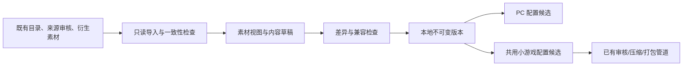

# 拼图内容管理后台：盘点与设计提案

日期：2026-10-12（北京时间）
状态：设计已于 2026-10-12 获用户“开始吧”确认；进入本地开发；不自动部署或发布生产内容。
目录：永久文件保存在 D:/chat/拼图。推荐后续独立后台工程为 D:/chat/拼图/content-admin。

## 已确认的用户方向

- 建立专门管理图片素材、图包、图鉴和发布版本的后台网站。
- 主要分组按画风（例如纸艺、二次元、写实）；题材作为标签。不要直接用现有 category 批量推断画风。
- 素材共用；PC 网页与小游戏分别配置内容。微信、TapTap 共用小游戏配置，未来抖音复用同一内容与实现。
- 本机 3213 是小游戏共享 Canvas 客户端预览，不构成第三种内容目标。
- 现有售价、归属、已购权益、图鉴进度与房间不能因后台建设被修改或丢失。
- 用户尚未给出逐包重组规则；先支持草稿整理，保持现状作为初始发布基线。
- 尚未开通对象存储/CDN；衔接已有审核、压缩、缓存和资源包流程，不申请或迁移云资源。
- 保留现有大量未提交工作，不重置、覆盖、清理或替用户提交其他改动。

## 只读盘点结果

本次核对的是 D 盘本地源码、内容清单与素材文件；未读取生产数据库、管理员密钥或玩家档案，未查询生产部署版本。因此以下数量是本地内容基线，不声称等于当前线上版本。

| 项目 | 核对结果 |
| --- | --- |
| 素材目录 | 两项目 puzzle-catalog.json 字节相同；134 张可恢复素材 |
| 状态 | 82 published、52 archived |
| 普通图库 | 79 张；另外 3 张 dailyOnly 且 galleryVisible=false |
| 全部方向 | 116 横图、2 竖图、16 方图，方向取来源记录真实尺寸 |
| 在架方向 | 64 横图、2 竖图、16 方图 |
| 来源 | 91 project-ai-generated、43 user-provided |
| 来源记录 | 135 个；额外的 hero-paper-coast-v2 是首屏布景，不进入拼图素材 |
| PC 主题画册 | lantern-stories，3 张图片；当前没有金币图包购买系统 |
| PC 成就 | 16 枚现有徽章，规则与小游戏图鉴奖励独立 |
| 小游戏图包 | cloud-wonders、blossom-lights、mountain-journey，各 6 张，当前各 180 金币 |
| 小游戏图鉴 | 上述 3 个图包的镜像，加 everyday-gallery 免费组 61 张 |
| 小游戏里程碑 | 共用 3 张奖励 30 金币、6 张奖励 60 金币和对应装饰 |
| 图片分发包 | 268 个 WebP，65,083,688 字节；包含在架和归档兼容图 |

两项目全部 134 张图片的原件与已登记衍生文件哈希一致，来源记录和图片引导也一致，未发现同 ID 不同画面。两套项目当前各有素材文件副本，这次不移动它们或改成共享软链接。

现有分类包含风景、生活、幻想、动漫、动物、街景、厚涂、平涂、艺术，混合了题材与画风。新增 styleGroupId 与 subjectTags，不回写旧 category，也不自动把风景等题材判为某种画风。

## 数据源与复用范围

| 数据或能力 | 现有位置 | 接入方式 |
| --- | --- | --- |
| 图片身份与上架元数据 | 两项目 content/puzzle-catalog.json | 只读导入，发布生成目标候选，不另建人工维护图库清单 |
| 原件、授权、审核与交付 SHA | content/image-provenance/<id>.json | 服务端完整校验，界面受管理员鉴权；公开交付只输出所需字段 |
| 尺寸、推荐片数与引导 | content/puzzle-guidance.json | 保留并随发布校验 |
| PC 画册 | puzzle-play/lib/puzzle-journey.ts | 适配现有 1 个主题；未来配置化时保留原 ID |
| PC 成就 | puzzle-play/lib/achievements.ts | 首期只读展示关联；不把小游戏金币奖励套到 PC |
| 小游戏图包、奖励和装饰 | jigsaw-nook-taptap/lib/mobile-collection-catalog.json | 草稿编辑；按现有契约生成兼容候选 |
| 小游戏权益与图鉴计算 | server/mobile-collection.mjs | 读取规则作发布兼容检查；首期不写玩家表 |
| 管理员模式 | lib/admin-store.ts、account-security.ts | 复用服务器鉴权、再次验密和操作原因的模式 |
| 已有管理页 | app/admin、app/api/admin/route.ts | 管理玩家/房间/成绩/隐私请求，无内容编辑；继续独立 |
| 审核与交付 | scripts/check-image-library.mjs、prepare-image-delivery.py、prepare-optimized-delivery.mjs | 发布作业复用现有来源判定和编码链，禁止另一份白名单 |
| 小游戏公开资源打包 | scripts/build-h5.mjs、package-mobile-assets.mjs | 从已验证目标候选自动生成 manifest 与资源包 |
| 资源地址 | config/mobile-platforms.json、JIGSAW_SHARED_ASSET_BASE | 延续现有独立资源地址开关，不自动切 CDN |

PC 的 local-db.ts 依赖 cloudflare:workers 环境，现有账号后台解析器最多 4 KiB；独立内容服务不直接导入玩家数据库模块，也不将批量内容写入硬塞进原接口。

PowerShell 属性未显示联接，但进一步用 Node fs.realpathSync 核对，C:/Users/Administrator/Documents/ChatGPT/拼图 及两项目路径均解析到 D:/chat/拼图 对应目录，关键文件一致。后续直接在 D 盘工作，保留现有 C 盘兼容入口，不迁移、删除或重建这层映射。

## 方案选择

推荐：独立内容后台 + 两个目标适配器。新增工程集中保存管理员会话、草稿、版本与发布作业，素材仍引用既有权威来源。初期只读导入，所有整理先进入草稿；发布生成可审阅候选与交付包。这样可以同时管理两端内容，并隔离玩家数据库和现有游戏运行。

备选一：扩展 PC /admin。可较直接利用现有账号，但 PC 框架/运行绑定会与小游戏内容和本地文件发布耦合；跨项目维护更困难。

备选二：接入通用 CMS。表单基础能力成熟，但稳定 ID、已购权益、图鉴幂等和已有图片交付链仍需专门适配；首期额外依赖较多。

推荐方案不新增第三套游戏内容或客户端，只新增管理工具。

## 后台页面与操作

1. 素材库：网格与列表、保持比例的横竖图预览；搜索 ID/标题，按画风、题材标签、来源、审核状态、状态、方向和内容目标筛选。详情展示真实尺寸、交付体积、审核依据和关联图包；批量调整管理标签/分组先进入草稿。旧 ID 只读；未分配画风显示“待分类”，不得默认为写实或二次元。
2. 图包：切换 PC/小游戏内容目标；新建、编辑标题说明、封面、选图、成员顺序、金币价格、画风组和草稿/上架/下架状态。封面单独配置，不能为改封面偷偷把第一张图片重排。现有小游戏运行时固定取 imageIds[0] 为封面，且没有上下架过滤；独立封面与旧图包下架先存规划草稿，导出时明确标注需要对应运行时适配，不能添加无人读取的字段冒充已生效。PC 当前没有金币图包机制，首期 PC 图包按主题画册管理，价格字段显示不适用。
3. 图鉴：管理独立分组、图片顺序、展示与里程碑草稿；显示当前来源关系。小游戏运行时目前把图鉴绑定图包，首期新增独立组/分组奖励可以保存为规划草稿，只有现有兼容结构能导出为运行候选；需运行时适配的条目清楚标注阻断原因。
4. 发布中心：选择草稿、查看逐项前后差异与影响目标，检查历史身份、资源、图包权益、里程碑和原目录顺序；显示可导出项和阻断项。含阻断项的目标不能生成可运行候选，可保存完整规划快照；若只生成兼容子集，必须由管理员显式选择并列出排除项，不能默默丢弃变更。发布为本地不可变版本与候选交付，不直接替换游戏源码、不上线生产。
5. 版本：查看操作者、原因、时间、内容摘要、输入清单 SHA、版本 SHA 和作业日志；从历史版本恢复为新草稿，再走同一校验和发布流程。

## 数据边界与发布模型

- 内容目标只用 pc 和 mobile-shared；微信/TapTap是部署渠道，不生成重复图包。
- 统一素材事实为 id、来源/授权、审核、尺寸、原件与衍生哈希；status、galleryVisible、dailyOnly、展示分类、图包和图鉴属于各目标配置。一端下架不能使另一端下架。旧 category 保持原值并独立保存在各目标中；新画风/题材是管理元数据。首次 publishedAt 保持不变。
- 首期以小游戏项目既有素材记录作为导入读取入口，同时校对 PC 对应记录；任一共同 ID 的来源、哈希或尺寸分歧都阻断合并，并提示人工处理。候选输出不会回写来源或覆盖另一项目。未来收口权威素材目录应作为单独可审阅迁移。
- 管理草稿只保存引用、管理画风/标签与目标内容配置。图片事实、来源审核与衍生物继续来自现有记录，不能手工改 SHA 或通过勾选伪造审核结论。
- 管理员数据、草稿、版本备份在后台私有运行目录。备份不在静态网站目录，不允许通过浏览器路径直接下载来源原件、数据库或密钥。
- 每个草稿记录来源内容 SHA 与 revision；保存比较 revision 防止覆盖其他窗口修改。发布时重新核对来源 SHA，若原项目已被其他会话修改则提示重新导入/合并，禁止覆盖。
- 发布流程：保存草稿 → 服务端校验 → 差异与阻断预览 → 验证当前管理员和操作原因 → 原子生成完整不可变版本、审计与候选 → 记录结果。失败不改变当前基线，也不产生半份可用版本。
- 本地“发布”不等于对玩家生效；界面称“生成发布候选”，并显示待接入/待部署状态。正式发布以后仍通过原项目发布工具处理，不隐含生产授权。
- 回退生成新草稿/新候选，不删除历史文件、原 SHA URL、玩家记录或已发奖励。
- 新图片导入需要来源说明/授权、真实审核、尺寸与原件 SHA，复用现有编码及检查脚本。未完成审核或压缩的图片可以保留入库草稿，但不能进入可发布资源包。

## 首期必须阻断的兼容变更

| 变更 | 实际风险 | 首期策略 |
| --- | --- | --- |
| 删除/改名历史图片 ID 或覆盖旧画面 | room-store 与 RESTORABLE_PHOTOS 依赖稳定 ID，旧房间可能 410 | ID 不可改；新画面新 ID；只归档，保留兼容资源 |
| 既有图包成员集合任意变化（新增、移除、替换）、删除旧图包 | ownedImageIds 每次由当前 pack.imageIds 推导，原权益、免费/收费边界和图鉴总数会变化 | 草稿允许规划；发布阻断，需单独权益快照/迁移方案 |
| mobile-shared 目标归档/隐藏被该目标图包引用的图片 | collection 只接收普通在架图库，服务启动会报 Collection artwork unavailable | 只阻断小游戏候选并列出引用；PC 目标独立判断，统一素材继续保留 |
| 修改旧图鉴 ID、里程碑 target/奖励定义、图包 decorationId 或关联奖励物定义 | 历史去重键为 owner+album_id+target，可能重复奖励或改变承诺 | 旧键和奖励定义冻结；新规则需有版本和独立迁移方案 |
| 改原 category 或图片源目录顺序 | 影响成就的风景判定、每日选图及历史日章 | 新画风/标签与图包排序另存；原字段/原顺序保留 |
| 删除旧哈希 WebP、把小资源包覆盖 PC/H5 资产目录 | 旧房间和旧客户端缺资源 | 归档/旧交付保留；目标资源包分别生成 |
| 隐式改 PC 收费或复制小游戏经济参数 | PC 当前没有这种权益和结算 | PC 先管理画册，不新增收费契约 |

价格、成员和奖励可以编辑为草稿，但当前 180 金币和 3/6 张奖励不会自动改变。既有图片从免费图库转入新收费图包也涉及选图权限变化，必须在差异中明确标识并等待内容与权益方案；首期导出不得隐含这种转换。

拟议兼容后续：购买时保存 pack revision 与当次图片集合，旧购买者拥有的图片集合只增不减；按 image ID 留存图鉴事实；将展示图鉴与奖励版本分离，奖励 key 稳定且结算幂等。后续需对旧购买记录做可审阅的映射回填，并明确房间创建与老成员续玩权限，再允许实际重组。此方案当前仅设计，不创建数据库迁移、不写玩家表。

## 管理员与服务器写入

本地服务仅监听 127.0.0.1，独立端口建议 3214。使用独立内容管理员身份，不复制玩家账号或将小游戏凭据当后台登录。无公开注册、默认万能账号或客户端提权；管理员初始化在本机完成，密码摘要使用成熟密码派生函数，会话 cookie 为 HttpOnly/SameSite 且有过期与退出。部署时强制 HTTPS/Secure。

所有读/写接口服务端验证管理员；写入额外验证同源 Origin 和 CSRF、防重放、内容类型和有界请求体。发布/回退需要再次验密和操作原因。静态图片预览仅放行目录清单中登记的 WebP，拒绝路径穿越、符号链接逃逸和任意文件读取。

结构校验包括：字段白名单、稳定且唯一 ID、价格/奖励非负安全整数、图片存在且审核/交付通过、封面关联、成员去重、里程碑范围、引用完整性、目标类型和兼容约束。并发保存/发布用 revision 比较及事务/原子指针，不允许最后一次写入静默覆盖。

## 聚焦验证与交付标准

依用户偏好，不做无关全量视觉或房间回归。首期集中验证：匿名/非管理员拒绝、CSRF与路径校验、合法/非法草稿保存、并发冲突、发布失败不改变版本、版本恢复、历史 ID/旧图包/里程碑阻断、审核与资源清单衔接；进行一次主要管理页面操作检查。若实际改到游戏内容适配器，再运行对应项目要求的类型检查、图片校验及相关内容测试，不跑整套房间/奖励压力测试。

首期可审阅交付应包含：本地后台访问地址、私有管理员初始化说明、来源盘点、草稿/候选/回退操作说明和聚焦验证结果。交付和文档集中于 D:/chat/拼图；只清理由后台自己生成且可核验的临时产物，不碰其他会话文件。

## 已确认的实施范围

用户已确认独立后台、画风主分组/题材标签、两个内容目标、本地候选发布及兼容阻断的首期方向。逐包图片重组、售价变更、免费/收费归属与独立图鉴奖励可以在后台草稿中继续梳理，无需在建设工具前一次决定完。

