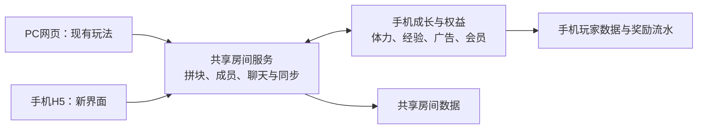

# 一起拼图 · TapTap 手机版策划案 V1

日期：2026-10-10  
状态：讨论稿；本次仅制定方案，未修改或部署游戏代码。  
目标：重建适合触屏的手机前端，形成轻量成长循环；PC 网页保留现有界面和玩法。手机与 PC 是否继续共用房间，按本案第八部分选择。

## 1. 产品方向与范围

推荐保留现有图片资产、拼图引擎和多人房间服务，重新制作手机端页面，并在共享服务端增加手机端规则。手机前端不再沿用完整网站导航。

核心循环：进入大厅 → 快速加入或创建 → 成功拼合获得经验 → 每十次获得体力奖励 → 升级增加上限并回满 → 继续拼图。

首版四个页面建议为：大厅、创建图库、拼图游戏、我的。用户原描述实际列出三个页面，“我的”为新增建议，集中展示等级、会员和设置，不恢复已要求删除的拼图记录功能。

此前确定的每日拼图仍保留为108片快捷入口。手机新建片数按上一轮要求暂定48、108、300、500；PC可选片数保持原样。超过500片的PC房间在手机是否可见仍属待确定事项，推荐手机默认不展示，通过产品规则区分可玩范围。

## 2. 四个页面

### 2.1 大厅：启动即进入

- 顶部一条轻量状态栏：头像/等级、体力。点击头像进入“我的”。不展示收藏、语言切换、广告福利、QQ群、介绍、统计和宣传页脚。
- 主要操作：快速加入、创建房间；每日拼图作为次要小按钮。
- 竖屏默认两列房间卡；横屏按可用卡片宽度自适应3～4列。卡片保留图片、名称、片数、人数、进度，计时放房间详情，减少卡片文字。
- 下拉刷新；滚动到底追加下一批，每批12个。刷新房间人数和进度时保留滚动位置，用户正在看的卡片不突然换位。
- 筛选用一条小工具栏，展开后选片数、图片方向（横图/竖图/方图）、可加入/有人在玩。图片方向筛选与手机屏幕横竖方向是两个功能。
- 快速加入尊重筛选条件，优先未满、可加入且有玩家的房间；不优先塞进马上结束的桌。无合适房间时提示“随机开一桌”，不自动播放广告。
- 新房间、自动续局都必须走相同的建房权益规则，不能绕过指定图片/私人房间的广告要求。

### 2.2 创建图库：选择后再开局

- 点创建房间进入；顶部只有返回、片数、公开/私人开关，下面即为图片网格。
- 默认108片，四档为48/108/300/500；选过的片数只在手机端记忆。
- 图片卡选择后显示简短底部操作条：“选定图片 · 108片 · 看广告创建”。会员显示“直接创建”。广告播放前明确图片、片数与房型。
- 一个独立“随机图片免费创建”按钮，始终创建公开房间；私人房间按私人房间规则。
- 搜索及图片分类收进筛选面板，不再占一整屏。暂不提供上传图片和自定义房间名，使用图片名称即可。
- 先完成图片与参数检查，再观看广告；完成后创建一次。网络失败保留这次创建机会供重试，不要求重复看广告。
- 48/108偏向短局；300为合作常用；500作为挑战。原引擎会按图片比例拟合实际网格，档位数与实际数量可能略有差异，是否改为严格精确片数需另行决定，不在本次强行更改图片裁切规则。

### 2.3 游戏：把空间留给拼图

- 竖屏顶部预留状态栏，底部预留工具栏，中间完整留给画布。工具栏参与布局，不浮盖在可操作拼块上。
- 状态栏显示返回、房间简名/人数、体力、等级经验。长标题截断，详情点击展开。
- 工具栏保留缩放/适配、边缘、提示、底图；聊天、声音、退出等进入更多菜单。聊天默认关闭。
- 横屏调整为上方薄状态栏＋侧边工具，画布按新的可用区域重排；切换方向后重新计算触控坐标和缩放范围，不仅旋转外观。
- 避开TapTap胶囊、刘海和底部系统手势区域。平台自己的内部测试提示不能作为自有页面内容删除。
- 其他玩家操作时显示“昵称 · Lv.12”；停手后短暂淡出，手机抬指后不长期挂在画布上。昵称截断，可在成员列表查看全名。
- 鼠标/指示器的颜色用于辨认玩家；等级颜色只用于旁边的小徽章。避免同等级玩家的指示器全变成同色。
- 无体力时仍可移动视野、查看房间和聊天，但不能拖动拼块产生进度。先结束手头那次有效结算，再判断是否需要补体力。

### 2.4 我的：等级和设置

展示头像昵称、等级/经验、体力上限、等级称号、会员权益、声音/震动/屏幕方向、账号绑定、帮助、隐私及反馈。通过头像进入，不设置占屏的四栏底部导航。

不设置历史房间、拼图记录和旧版续拼卡。删除手机入口不删除后端已有房间、PC记录或玩家数据；刷新与断线重连仍是基础能力。

成长数据保存在服务端。游客可先玩，需明确游客身份更换或清除后找回受限；通过已验证的平台身份或账号绑定获得稳定身份。TapTap账号自动绑定目前不是已完成能力，需要单独接入。

## 3. 拼合、体力与经验的计数口径

这是需要优先确认的设计选择。建议V1按“一次产生新进度的有效拼合操作”计数，与严格逐物理拼块扣费不同：

| 操作 | 体力 | 经验/十格进度 |
|---|---:|---:|
| 单片成功连接或首次有效归位 | -1 | +1 |
| 拖动已拼好的整组，与另一组成功连接 | -1 | +1，整次最多一次 |
| 拖错、松开未吸附、看图、缩放 | 0 | 0 |
| 重复请求、重连、重复已有关系 | 0 | 0 |
| 其他玩家或PC玩家完成操作 | 本人不扣 | 本人不加 |

这样不会出现拖动一整组突然扣掉几十点体力的情况，但玩家完成一张108片图不保证恰好得到108经验。已经计分的同一拼合关系不能重复刷分；整组搬动、重新入房不算新进度。若最终坚持逐物理拼块计数，必须改为记录每片首次计分归属，并处理两组各含多片时的归属和批量扣费，不能混用两种口径。

每次操作由服务端在同一次权威结算中处理：体力是否足够 → 拼图是否真实产生新进度 → 扣体力与加经验 → 升级 → 十格奖励 → 返回结果。两人同时拖同一块、同账号跨房间、多设备、断线重试，都不能重复扣费或奖励。

## 4. 等级和体力数值建议

- 初始为Lv.0，体力50/50；拼合一次升Lv.1，上限51并回满。
- 体力上限=50+等级；每升级一次增加1，并回满至新上限。
- 每次有效拼合获得1经验，本级经验满后升级；多余经验保留。
- 升至1～10级分别需要本级经验：1、5、10、18、28、40、55、70、90、110。
- 从11级起，每级需求比前一级增加10，最高300经验一级，避免后期需求无限增长。

| 升至等级 | 从前一级升来需要 | 累计经验 | 体力上限 |
|---|---:|---:|---:|
| 1 | 1 | 1 | 51 |
| 2 | 5 | 6 | 52 |
| 3 | 10 | 16 | 53 |
| 5 | 28 | 62 | 55 |
| 10 | 110 | 427 | 60 |
| 20 | 210 | 2077 | 70 |
| 30 | 300 | 4717 | 80 |
| 50 | 300 | 10717 | 100 |

这些是首轮体验测试起点，不是已验证的最终平衡。每十次均匀奖励1～5，平均回3点，平均净消耗为0.7/次；不考虑升级、自然恢复和奖励离散性时，50点体力约支持70次有效拼合。前几级频繁回满会进一步延长首次游玩，不能理解成玩50次一定需要广告。

按用户原想法，体力耗尽后主动观看一次完整激励视频回满至当前上限；广告不增加永久上限，永久上限只由升级增加。观看失败或提前关闭不扣体力、不发对应广告奖励。

新增建议（尚待决定）：每3分钟自然恢复1点，离线同样恢复，最高到上限。这样没有广告库存、玩家暂时不想看广告时仍有回来的理由；如果选择仅广告恢复，就要接受体力为0且暂无广告时无法继续拼合。普通浏览器中的H5也不能默认获得TapTap原生广告能力，因此需要自然恢复或独立支持的广告方案，不能靠本地倒计时冒充看广告。

## 5. 十格奖励：始终可见、自动到账

推荐“十格小礼盒”，在状态/工具栏里占一个固定位置，例如“🎁 7/10”。它属于界面保留区域，不覆盖画布。

- 玩家自己的每次有效拼合点亮一格，跨房间保留进度。
- 每满10格必定获得一次奖励，金额为1～5点体力，初版各20%概率；随机的是金额，不是是否中奖。
- 服务端抽取并自动到账，播放约0.6秒小动画，“体力+3”短暂出现后消失，玩家不用停手领取。
- 升级使用约0.8秒光效和可关闭的轻震动，显示“Lv.8 · 体力已充满”，不弹遮挡游戏的大窗。
- 升级与十格奖励同一次触发时合并提示。先升级回满，再发奖励；超过上限的少量体力暂存，最多5点，后续有空位自动补入，避免“领奖了却没增加”的感受。
- 第10次操作恰好耗尽体力时，先结算这次奖励/升级，再决定是否显示补体力按钮。
- 1～5点体力不能购买、转赠、交易或提现；首版不加付费抽取、连续连胜要求和额外货币，保持规则简单。

“爽感”主要来自吸附音与轻震动、每十次的小奖励、前期高频升级、升级回满以及合作完成的短庆祝。不要依靠持续弹窗或整屏彩带。拼图完成后可用短结算面板展示本局自己的贡献、经验、等级变化和奖励，再选随机下一局或返回大厅；这不是长期拼图记录页。

## 6. 广告、会员与创建规则

| 行为 | 普通玩家 | 会员建议权益 |
|---|---|---|
| 加入公开房间/快速加入 | 免费，不看广告 | 相同 |
| 随机图片创建公开房间 | 免费，不看广告 | 相同 |
| 指定图片创建公开房间 | 一次完整广告给一次创建机会 | 免创建广告 |
| 创建私人房间 | 一次完整广告给一次创建机会 | 免创建广告 |
| 指定图片＋私人房间 | 总共一条广告，覆盖该次完整创建请求 | 免创建广告 |
| 体力回满 | 主动看一次完整广告；自然恢复为可选建议 | 首版同样消耗体力，是否另送每日补给待定 |

加入别人已创建的私人房间按邀请权限进入，不再向每位加入者收创建广告。创建权益绑定本次图片、片数与房型；只能成功创建一次。失败保留权益供重试，重复提交返回同一房间，不连建多个。私人房间仍有并发/数量限制，图片所有权校验不能因为看广告而绕过。

随机房间虽免费，也需防止连续刷新刷出指定图片和制造空房。建议对连续新建加短冷却、复用自己刚创建的未开局空房，并回收长期空置的房间；不要为普通合作拼图增加大量障碍。

之前的“提示/底图每次都看广告”与现在的“体力＋建房广告”叠加，会明显打断体验。建议首版把商业化重点放在体力和指定建房，提示/底图每局先各给2次免费，用尽后按需看广告。这是对旧规则的建议修改，尚未实施，需用户决定。

会员购买不能视作现成能力。当前游戏走创意工坊H5路径；TapTap官方IAP文档明确说明，该文档的支付能力适用于普通TapTap小游戏，不适用于创意工坊和TapTap制造。首版可完成会员权益模型与测试账号，正式售卖和购买入口需先确认所选发行路径支持的支付/商品方式；不先跳转外部付款绕过平台约束。

广告按官方完整播放回调判定，不写死30秒，也不把本地计时器当作完成证明。服务端要记录一次性奖励凭据并防重复；若平台提供可用的服务端完成校验，应接入。仅客户端完成回调不能宣称具有强防伪能力，因此与正式付费权益分开核验。

## 7. 等级颜色与玩家识别

| 等级 | 称号建议 | 徽章主色 |
|---|---|---|
| 0～4 | 新手拼友 | 石板灰 #64748B |
| 5～9 | 初见默契 | 草木绿 #15803D |
| 10～19 | 熟练拼友 | 湖蓝 #0369A1 |
| 20～29 | 拼图能手 | 紫罗兰 #7C3AED |
| 30～49 | 拼图达人 | 琥珀 #B45309 |
| 50及以上 | 拼图大师 | 玫瑰红 #BE123C |

颜色搭配白色等级数字、小型边框与图标；具体对比度在视觉稿上验收。等级数字始终显示，不能只靠颜色辨认。房间成员固定识别色保持独立。PC玩家没有手机成长数据时显示“Web”，不伪造等级，也不因同房其他人拼图自动升级。

## 8. 后端：推荐保留房间同步，扩展手机规则

### 8.1 推荐方案

PC前端与手机前端分别维护；共用拼图房间的唯一权威状态，新增手机端成长与权益模块。同步必须保留，负责拼块位置、占用、进度、成员、鼠标、聊天与断线恢复。当前项目已有这些能力，没有必要因为UI改变而整体重写。

当前实现使用HTTP增量轮询，并非现成WebSocket服务。首版可以沿用；测试移动网络流量、延迟与后台耗电后，再决定是否把同步传输替换为WebSocket。不要让UI重做同时承担一次没有验证必要性的网络重写。

体力扣除必须进入权威房间操作路径，单独在H5页面或网关拦截不够。服务端决定有效进度和奖励，并将房间变化、体力、经验、奖励结果一致地保存。成长数据可新增独立表或模块，技术选型依据现有数据库能力，不运行两个互不协调的房间写入程序。

建议新增：玩家成长、体力变更、有效拼合事件、广告完成/兑换、建房权益、会员权益。客户端显示和动画与权威结果对齐；请求重试、切前后台、账号跨设备都不重置体力或重复领奖。

用服务器签发的会话/房间票据标记规则版本，例如classic与mobile-v1，不信任前端自行上传的“我是PC”字段。PC操作不扣手机体力，也不获得手机经验；只结算实际操作的那个手机身份。同账号绑定和游客迁移要防止重复合并体力或经验。

### 8.2 共用房间的产品代价

普通网站仍公开且免体力，手机用户也能在浏览器打开它。因此只能做到不同渠道有不同成长规则，不能承诺把“所有手机设备”都锁定到体力规则。

共用房间时，PC伙伴可以免费帮助手机玩家完成拼图；PC创建的指定图片房也可以被手机玩家免费加入。这与“加入免费、广告只约束手机建房”一致。如果商业目标要求选图/拼图必须经过相同体力和广告规则，应分开房间池，而不是试图通过隐藏按钮做到。

| 方案 | 优点 | 代价 | 建议 |
|---|---|---|---|
| 共用房间＋手机独立成长 | 保留原先跨端同玩，复用现有服务 | 接受PC免费协助、渠道规则不同 | 首版推荐 |
| 共用基础服务＋分开房间池 | 手机数值、广告与榜单更独立 | 默认不能同房；可另设明确的经典联机入口 | 商业规则优先时选择 |
| 完全独立新后端 | 彻底独立生命周期 | 重复开发同步、账号、运维，不能天然同房 | 当前不推荐 |

### 8.3 已核查的代码现状

- 已有有效拼合贡献、鼠标姓名、房间同步与广告适配，可以复用；还没有本案完整的等级/体力经济系统。
- 48片在旧关卡恢复/网格能力中存在，但新房间校验当前不接受48；48片的部分种子开局恢复也需要兼容。不能只增加一个48按钮。
- 现有私人建房依赖会员，500片创建需要账号。新手机规则必须由服务端明确接纳广告建房权益与手机身份，PC入口保持自己的规则。
- 手机新建500上限不会自动改变PC已有1000片房间。需要明确手机是否隐藏/拒绝加入高片数房间。

## 9. 实施顺序与验收

1. 先确认本稿核心产品选择，制作大厅、图库、游戏、我的的手机视觉稿，先验收可用区域和横竖屏。
2. 开发独立手机界面：启动大厅、两列卡片、滚动加载、筛选、图库创建、48～500档位、无挡手游戏布局。
3. 增加服务端成长账本与有效操作结算；先用测试账号和无支付环境验证扣费、升级、十格奖励及重连。
4. 接入真实激励视频和一次性建房机会，验证广告失败、提前关闭、无库存、重复回调、创建失败后重试。
5. 测试两台手机、PC与手机同时操作、横竖屏切换、弱网、多账号/多设备；确认PC页面与原玩法不回归。
6. 确认平台支持路径后再开会员正式售卖。每阶段先上传开发测试版本，不自动审核或发布。

首版重点指标：从打开到开始拼图的步骤和耗时、误触与遮挡、首轮有效拼合数、首次体力耗尽时点、广告可用率与主动观看率、体力耗尽退出率、定图创建完成率。先看是否愿意继续玩，再调节数值和广告频次，不把预期收益当成保证。

## 10. 建议优先确定的事项

1. 是否采用“共用房间、手机独立成长”，接受PC免费协助？推荐采用。
2. 扣体力按一次有效拼合操作，还是严格按每个首次计分的物理拼块？推荐前者，手感和组块行为更可控。
3. 是否采用每3分钟恢复1点体力？推荐采用，作为广告无库存和非TapTap浏览器的退路。
4. 会员正式支付尚未确定；首版是否先广告模式、后开会员销售？推荐这样推进。
5. 旧提示/底图的逐次广告，是否改为每局各2次免费？推荐减少广告叠加。
6. 第四页采用“我的”；片数先48/108/300/500；超过500的PC房手机默认隐藏，具体跨端可见范围需最终确认。

## 官方依据

核对日期：2026-10-10。产品数值与UI为本案建议，不是平台强制规范。

- [TapTap广告接入指南](https://developer.taptap.cn/minigameapidoc/quick-start/mcp-guide/ad-integration-guide/)：说明H5广告支持范围、用户主动观看及失败处理。
- [TapTap激励视频广告](https://developer.taptap.cn/minigameapidoc/dev/tutorial/open-capabilities/ad/rewarded-video-ad/)：完整观看按isEnded确认，提前关闭不发对应奖励。
- [TapTap IAP游戏](https://developer.taptap.cn/minigameapidoc/quick-start/monetization/IAP-game/)：该内购说明不适用于创意工坊和TapTap制造；正式购买权益需要服务端验证与发放。